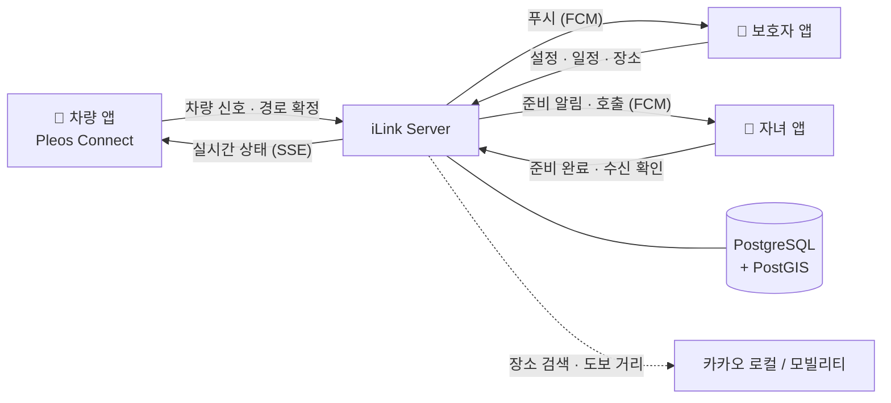
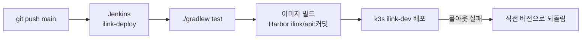

<div align="center">

# iLink Server

**아이를 데리러 가는 길, 차가 멈춘 순간에 아이를 부릅니다.**

학원 하원 픽업을 돕는 Pleos Connect 차량 앱 · 보호자 앱 · 자녀 앱의 공용 백엔드


</div>

---

## iLink는

학원 앞 픽업은 매번 같은 문제를 겪습니다. 아이는 차가 어디쯤 왔는지 몰라 길가에서 기다리고, 보호자는 운전 중에 전화 · 메시지로 아이를 부릅니다.

iLink는 **차량의 실제 정차 신호**를 기준으로 아이를 부릅니다. 차가 멈추기 전에는 아이가 실내에서 기다리고, 정차가 확인되면 그때 이동을 안내합니다.

| | 기능 | 서버가 하는 일 |
|---|---|---|
| 🚗 | **차량 위치 · 도착 예정** | 차량 앱이 15초마다 보내는 위치 · 남은 거리 · 도착 예정 시각을 자녀 화면에 전달 |
| 🅿️ | **정차 판정** | 기어 P · 장소 반경 신호로 「이동 중 → 접근 중 → 정차 완료」 단계 판정 |
| 📣 | **자녀 호출** | 자동 호출 / 보호자 확인 호출. 도착 3분 전 · 700m · 정차 확인 조건을 서버가 판정 |
| 📍 | **여기로 부르기** | 예정 장소에 못 서면 지금 정차한 곳으로 한 번에 장소 변경 + 호출 |
| 🏫 | **실내 준비 알림** | 정차 예상 시각을 거꾸로 계산해 아이에게 미리 준비 알림 |
| 🛡️ | **자동 철회** | 정차 실패 · 차량 재출발 · 신호 끊김이면 호출을 자동으로 거두고 실내 대기 안내 |
| 🚪 | **탑승 확인** | 정차 중 도어 열림 → 닫힘으로 탑승을 인식하고 픽업 완료 |
| 🔒 | **위치 최소 사용** | 자녀 위치는 픽업 진행 중 · 동의한 경우에만. 끝나면 자동 중단 |

## 함께 쓰는 앱

| 저장소 | 내용 | 기술 |
|---|---|---|
| **iLink-Server** (이 저장소) | API · 호출 판정 · 알림 · 실시간 상태 | Java 21, Spring Boot 4, PostgreSQL + PostGIS |
| [iLink-Vehicle](https://github.com/Hyundai-Motor-Competition/iLink-Vehicle) | Pleos Connect 차량 앱 | Kotlin, Jetpack Compose, Pleos Connect SDK |
| [iLink-Client](https://github.com/Hyundai-Motor-Competition/iLink-Client) | 보호자 · 자녀 모바일 앱 | React Native, TypeScript, FCM |

## 구조



## 도메인과 API

API 68개. 도메인마다 설계서(`docs/`)의 체크리스트를 테스트로 먼저 쓰고 구현했습니다.

| 도메인 | 설계서 | API | 주요 내용 |
|---|---|---|---|
| 공통 | [03](docs/03_공유모듈-shared.md) | - | 오류 응답 형식, JWT 인증, Idempotency-Key, 요청 로그, 시간 · 좌표 |
| 사용자 | [04](docs/04_사용자-user.md) | 8 | 가족 · 멤버(보호자 · 공동 보호자 · 대리인 · 자녀), 차량 연결, 합류 안내 방식 |
| 인증 | [05](docs/05_인증-auth.md) | 12 | 기기 등록, 차량 연결 코드(QR), 초대, access · refresh 토큰, 동의 |
| 일정 | [06](docs/06_일정-schedule.md) | 10 | 학원 · 요일별 일정, 주간 픽업, 오늘 픽업 타임라인, 다음 픽업 |
| 장소 | [07](docs/07_장소-place.md) | 6 | 정차 지점 · 만남 지점, 근처 추천 장소, 임시 장소 |
| 픽업 | [08](docs/08_픽업-pickup.md) | 29 | 픽업 세션, 경로 확정, 호출 · 보류 · 철회, 탑승 · 완료, 실시간 스트림 |
| 알림 | [09](docs/09_알림-notification.md) | 3 | FCM 발송 · 재발송, 수신 확인, 알림 이력 |
| 프로필 사진 | [10](docs/10_프로필사진-profile.md) | - | 멤버 사진 저장(MinIO) · 서명 URL |

API 문서는 dev 서버의 Swagger UI에서 볼 수 있습니다: `https://ilink-api-dev.chisanw.com/swagger-ui.html`

## 빠르게 실행하기

**DB 없이 바로 실행** (테스트 DB로 뜨고, 끄면 데이터가 지워집니다)

```bash
./gradlew bootTestRun
```

**dev DB를 띄워서 실행**

```bash
docker run -d --name pickup-dev-db -p 5432:5432 \
  -e POSTGRES_DB=pickup -e POSTGRES_USER=pickup -e POSTGRES_PASSWORD=<비밀번호> \
  postgis/postgis:17-3.7

SPRING_PROFILES_ACTIVE=dev DB_PASSWORD=<비밀번호> JWT_SECRET=<Base64 키> ./gradlew bootRun
```

PowerShell:

```powershell
$env:SPRING_PROFILES_ACTIVE="dev"; $env:DB_PASSWORD="<비밀번호>"; $env:JWT_SECRET="<Base64 키>"; .\gradlew.bat bootRun
```

준비물: JDK 21, Docker(dev DB용. Windows에서 테스트만 돌릴 때는 필요 없음)

<details>
<summary><b>환경 변수</b></summary>

비밀값은 설정 파일에 넣지 않고 환경 변수로만 넣습니다.

| 이름 | dev | prod |
|---|---|---|
| `SPRING_PROFILES_ACTIVE` | `dev` | `prod` |
| `DB_URL` | 없으면 `jdbc:postgresql://localhost:5432/pickup` | 필수 |
| `DB_USERNAME` | 없으면 `pickup` | 필수 |
| `DB_PASSWORD` | 필수 | 필수 |
| `JWT_SECRET` | 필수 | 필수 |
| `PHONE_ENCRYPTION_KEY` | 필수 (전화번호 암호화 키) | 필수 |
| `KAKAO_REST_API_KEY` | 선택 (학원 · 장소 검색, 도보 거리) | 선택 |
| `FCM_CREDENTIALS_PATH` · `FCM_PROJECT_ID` | 선택 (푸시 발송) | 선택 |
| `MINIO_ENDPOINT` · `MINIO_PUBLIC_ENDPOINT` · `MINIO_BUCKET` · `MINIO_ACCESS_KEY` · `MINIO_SECRET_KEY` | 선택 (프로필 사진 저장소) | 선택 |

`JWT_SECRET`은 access 토큰 서명 키(HS256)입니다. 32바이트 이상 임의 값을 Base64로 넣습니다. 예: `openssl rand -base64 32`. 테스트와 `bootTestRun`은 실행할 때 임의 키를 만들어 쓰므로 넣지 않아도 됩니다.

</details>

<details>
<summary><b>dev DB 주의</b></summary>

dev는 `ddl-auto: update`라 컬럼 추가는 자동이지만, 컬럼 삭제 · NOT NULL 해제 · 기존 행이 있는 테이블의 NOT NULL 컬럼 추가는 반영되지 않습니다. 그런 변경이 들어오면 dev DB 컨테이너를 지우고 다시 띄우거나 SQL을 직접 실행합니다.

</details>

## 테스트

```bash
./gradlew test
```

- 3,045개 테스트가 실제 PostgreSQL 17 + PostGIS에서 돕니다. 설치할 것은 없습니다.
- 테스트 DB는 OS로 정해집니다. 강제로 고르려면 `-Ppickup.test.db=embedded` 또는 `-Ppickup.test.db=testcontainers`.

| 방식 | 언제 | 내용 |
|---|---|---|
| `embedded` | Windows | Docker 없이 내장 PostgreSQL 17 + PostGIS 3.6 Windows 묶음(Gradle이 받아 둠) |
| `testcontainers` | 그 밖의 OS, CI | `postgis/postgis:17-3.7` 컨테이너. Docker 필요 |

DB가 닿는 테스트는 `common.fixture.IntegrationTestSupport`를 상속합니다. 테스트 DB · 임의 JWT 키 · 테스트용 access 토큰(`AccessTokenFixture`)을 묶어 줍니다.

## 배포

`main`에 push하면 홈서버 Jenkins가 테스트부터 배포까지 자동으로 진행합니다.



| 항목 | 값 |
|---|---|
| dev 주소 | `https://ilink-api-dev.chisanw.com` |
| 헬스 체크 | `GET /actuator/health` (인증 없이 열림) |
| 매니페스트 | `ops/k8s/dev/api.yaml`(파이프라인이 매번 적용), `postgres.yaml` · `deployer.yaml`(한 번 적용) |
| 비밀값 | k8s Secret `api`. 홈서버에서 `ops/scripts/ilink-secrets.sh`로 편집 |

<details>
<summary><b>DB 구조 변경이 있는 배포</b></summary>

- dev는 `ddl-auto: update`라 새 컬럼 대부분은 자동으로 생깁니다. 기존 행이 있는 테이블에 NOT NULL 컬럼을 넣거나 유니크 키를 바꾸는 변경은 배포 전에 SQL을 직접 실행합니다.
- prod는 `ddl-auto: validate`라 서버가 테이블을 만들지 않습니다. 새 테이블 · 컬럼 DDL을 먼저 실행하고 서버를 띄웁니다. `src/main/resources/schema.sql`의 인덱스는 `IF NOT EXISTS`라 서버가 뜰 때 만들어집니다.

</details>

## 기술 스택

| 구분 | 사용 기술 |
|---|---|
| 언어 · 프레임워크 | Java 21, Spring Boot 4.1.2 (Spring Framework 7, Spring Security 7), Gradle 9.8 |
| DB | PostgreSQL 17 + PostGIS 3.7, Hibernate ORM · Spatial 7.4 |
| 인증 | Spring Security OAuth2 Resource Server (JWT, HS256) |
| 실시간 | SseEmitter(차량 앱 스트림), Firebase Admin SDK 9.11(FCM 푸시) |
| 외부 연동 | 카카오 로컬 · 카카오모빌리티(RestClient), MinIO 9.0(프로필 사진) |
| 문서 | springdoc-openapi 3.2 (dev에서만) |
| 테스트 | JUnit 6, embedded-postgres(Windows) · Testcontainers 2.0(그 밖의 OS) |
| 배포 | Docker, Jenkins, Harbor, k3s |

## 폴더 구조

```text
src/main/java/com/example/pickupservice
├─ common         오류 · 인증 · Idempotency · 로그 · 시간/좌표 · 스케줄러
├─ user           가족 · 멤버 · 차량
├─ auth           기기 · 토큰 · 차량 연결 코드 · 초대 · 동의
├─ schedule       학원 · 픽업 일정
├─ place          픽업 장소 · 추천
├─ pickup         픽업 세션 · 호출 · 실시간 스트림
└─ notification   푸시 발송 · 재발송 · 이력
```

도메인마다 헥사고날 구조를 따릅니다.

```text
{도메인}
├─ adapter/in/web (+ doc)   컨트롤러, 요청 · 응답 DTO, Swagger 문서 인터페이스
├─ adapter/out/persistence  JPA 엔티티, 저장소
├─ application/port/in · out
├─ application/service
└─ domain                   Spring에 의존하지 않는 도메인 규칙
```

## 설계 문서

| 문서 | 내용 |
|---|---|
| [docs/02_공통-규칙-global.md](docs/02_공통-규칙-global.md) | 공통 규칙 (기술 스택, 오류 형식, 인증, 테이블 규칙) |
| `docs/03` ~ `docs/10` | 도메인별 설계서 (API 명세, 핵심 로직, 테스트 체크리스트) |
| [docs/followup/](docs/followup/) | 도메인별 진행 기록 · 리뷰 · 후속 과제 |
